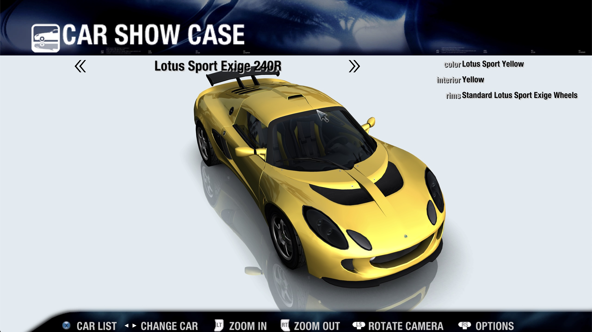
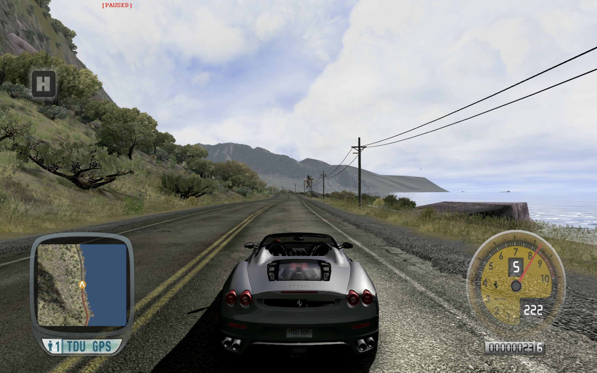
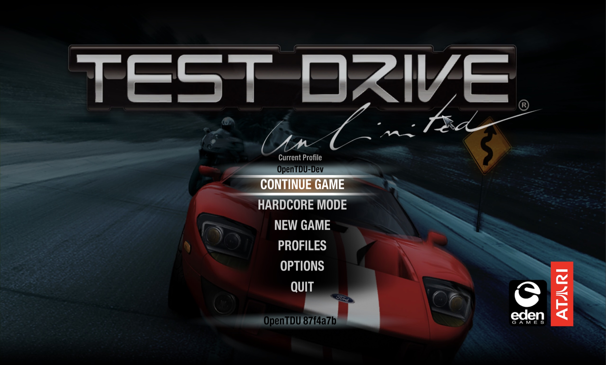
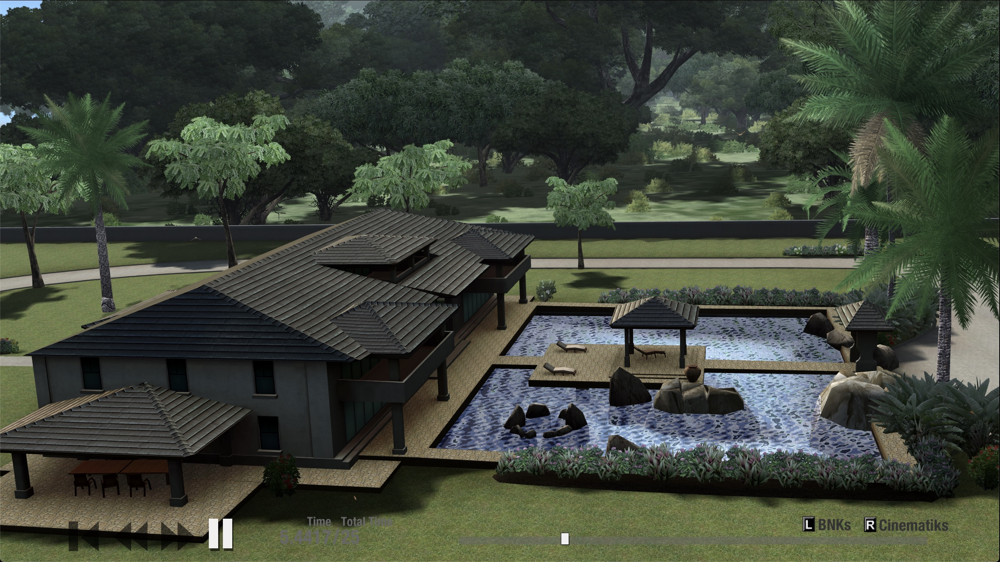
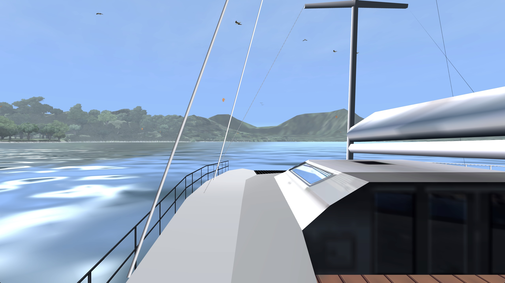
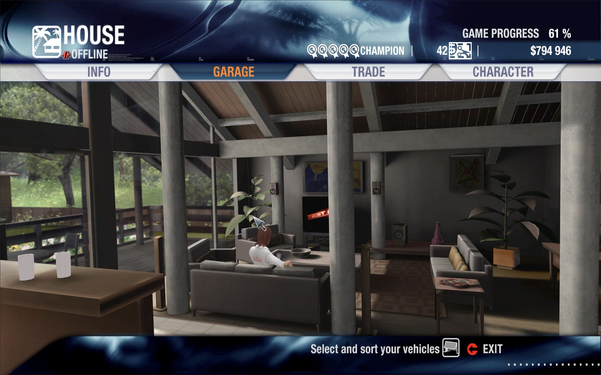
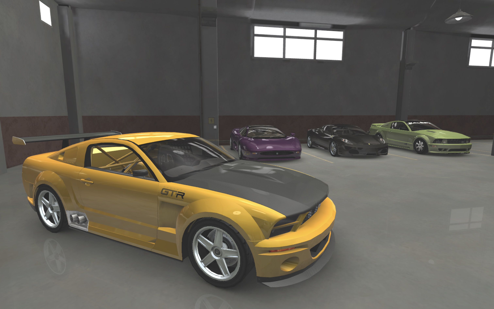
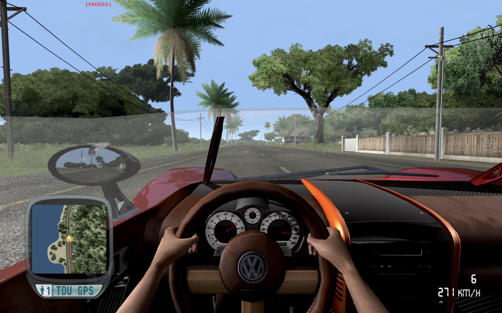

# Open Test Drive Unlimited (OpenTDU)
  

Source port of Test Drive Unlimited PC (TDU) (MC 1.66A)

**WORK IN PROGRESS**

The goal of this project is to create a new client fixing various issues encountered on modern systems (AI, rendering, security, etc.) as well as providing cross-platform compatibility.

**This project is not a replacement for the game (you still need to own a legal copy); and does not provide any game assets!**

         

Regular updates/screenshots can be found in this [thread](https://github.com/opentestdriveunlimited/OpenTestDriveUnlimited/discussions/175).

## Download
Nightly binaries are available here: [https://github.com/opentestdriveunlimited/opentestdriveunlimited/releases](https://github.com/opentestdriveunlimited/opentestdriveunlimited/releases). 

## Installation
Copy the opentdu binary and EURO folder content (**must be merged with your original EURO folder; THIS IS NOT A REPLACEMENT FOR YOUR ORIGINAL EURO FOLDER**) to your TestDriveUnlimited folder.

## Dependencies
* CMake (3.15 or newer)
* C++17 compiler (eg. clang; gcc or MSVC)
* Vulkan SDK (1.3.204.0 or newer)

## Build instructions
1. Clone the code using: `git clone --recursive git@github.com:opentestdriveunlimited/OpenTestDriveUnlimited.git`
2. Run the build script for your host platform (`build_win.bat x64` for **Windows** or `build_unix.sh` for **Linux or macOS**)

## Command Line Arguments
| Command | Description |
| ----------- |  ----------- |
| -w | Enable windowed mode |
| -vbl (value) | Set target vsync blank |
| -fps | Enable FPS counter |
| -pos | Enable debug position text overlay |
| -orb | Override ORB address for online login |
| -nopub | Disable GSPub |
| -gm (id) | Launch game with a specific game mode (see eGameMode) |
| -worldviewer | Launch world viewer |
| -carshowcase | Launch car showcase (alias for '-gm 7') |
| -cinviewer | Launch cinematic viewer (alias for '-gm 20') |
| -freeride | Launch cinematic viewer (alias for '-gm 1') |
| -login | Launch login screen (alias for '-gm 24') |
| -vk_enable_validation_layer | Create Vulkan render device with validation layer enabled |
| -break_on_assert_failure | Trigger debug breakpoint on assert failure |
| -disable_assert | Disable assert log/debug break |
| -norunlock | Disable single game instance run lock |
| -profile (name) | Launch game with a specific profile (must match savegame name) |
| -car (id) | Override the local player car in world game modes (e.g. freeride) with a car database ID |
| -silent | Disable logging (stdout, outpudebug and file) | 
| -log (path) | Redirect game logs to a specific file (default: ./opentdu.log) |
| -nolog | Disable logging to file (note: does not disable stdout/outputdebug) |
| -logtransient | Write transient log to file |
| -verbose | Enable verbose (aka Debug) logging. Adds significant runtime overhead |
| -maxfps (fps) | Set framecap (0: unlimited) (default: 0) |

## Debug Menu
Debug Menu can be toggled with the *F1* key.

## Project progress
Progress is tracked on a game mode basis:
| GameMode  | Status |
| -----------  | ----------- |
| VideoBumper|**Done**|
| CarShowCase|**Done**|
| Sandbox|**Done**|
| Login|**Done**|
| CinViewer|**Done**|
| BoatTour|**Done**|
| Living|**In Progress**|
| Garage|**In Progress**|
| Dressing|**In Progress**|
| FreeRide|**In Progress**|
| Jail|**In Progress**|